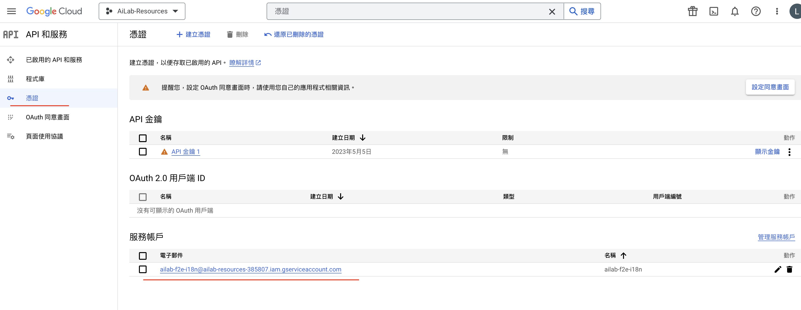

# 使用 google sheet api 處理前端翻譯

### # SheetToJson.js

將線上 google sheet 載回專案作為翻譯使用

全選

```bash
node SheetToJson.js
```

單選或複選

```bash
node SheetToJson.js common nova88
```

### # SheetSort.js

整理線上 google sheet 按照 key 值排序，定期手動整理

```bash
node SheetSort.js
```

### # SheetOutput.js

將當前專案翻譯輸出至指定 google sheet，平常不會用到，請勿自行使用

全選

```bash
node SheetOutput.js
```

單選或複選

```bash
node SheetOutput.js common nova88
```

---

### # 管理 sheet api 與憑證

> 工作台：https://console.cloud.google.com/
> 帳號：ailabpte@gmail.com

點擊 選取專案 => 快速存取 API 和服務 => 憑證 => 服務帳戶 來觀看相關資訊



```tsx
const serviceAccountAuth = new JWT({
	email: auth.client_email,
	key: auth.private_key,
	scopes: ['https://www.googleapis.com/auth/spreadsheets'],
})

const SHEET_URL_ID = '1yQNCCdV2UGOGE8-GhM0eOMEoTG23F0JpcR5pf5tTq5E'

const outputData = async ({ tab, headerRow, contents }) => {
	const doc = new GoogleSpreadsheet(SHEET_URL_ID, serviceAccountAuth)
	await doc.loadInfo()
	// ...
}
```

serviceAccountAuth：由 JWT 驗證身份並
