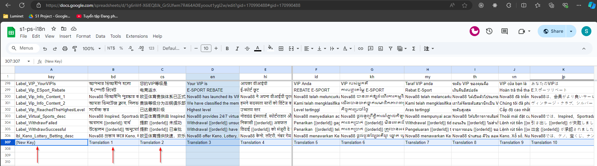
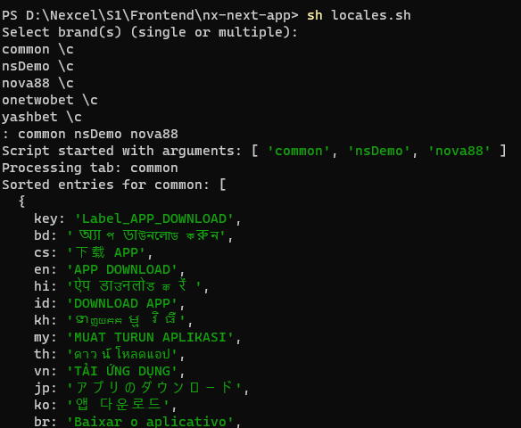
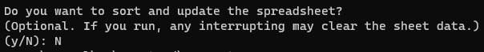

## S1 Translation

### Sync Translation

#### 1.Update site Translation in [S1 google sheet](https://docs.google.com/spreadsheets/d/1g6nVrf-X6lEQ8Jk_GrSUfwm7R464A0lEyoout1ygI2w)



#### 2.Run locales script (skip optional)



>Skip sort sheet step



#### 3.Result

```bash
.
└── public
    └── locales
        ├── en
        |   └── common.json
        └── cs
            └── common.json
```

### Setup

#### 1.Set Default Namespace

```js
// path:apps/app/next-i18next.config.js
const isDevelopment = process.env.NODE_ENV !== 'production'

module.exports = {
  i18n: {
    defaultLocale: 'default',
    locales: ['default', 'en', 'cs', 'th', 'en-th'],
    defaultNS: process.env.NEXT_PUBLIC_SITE_NAME,
    fallbackNS: 'common',
  },
  reloadOnPrerender: isDevelopment,
}
```

#### 2.Setup at App Level

```tsx
import { appWithTranslation } from 'next-i18next'

const CustomApp = ({ Component, pageProps }) => <Component {...pageProps} />

export default appWithTranslation(CustomApp)
```

#### 3.Setup at Pages Level

```tsx
import { serverSideTranslations } from 'next-i18next/serverSideTranslations'

export async function getStaticProps({ locale }) {
 return {
  props: {
   ...(await serverSideTranslations(locale)),
   // Will be passed to the page component as props
  },
 }
}
```

#### 4.Use Translation

```tsx
import { useTranslation } from 'next-i18next'

export const Footer = () => {
 const { t } = useTranslation()

 return (
  <footer>
   <p>{t('description')}</p>
  </footer>
 )
}
```

#### [Reference](https://github.com/i18next/next-i18next/blob/master/README.md)
