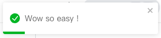
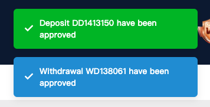

# 吐司通知發送器

- 提供了一個靈活的方法來發送各類型的吐司通知。透過 `react-toastify` 實現，支持多種自定義選項，包括背景顏色、圖標等，以適應不同的使用情景。如果有需要更多自定義參數，可以自行增加 `ToastEmitter` 函式的自定義參數傳入。

# react-toastify 官方教學

- https://fkhadra.github.io/react-toastify/installation/

# 關於 D0001/toast 組件 與 H0001/toast 組件

- 此組件是透過 `react-toastify` 實現，而 `react-toastify` 套件本身就有使用 RWD 的功能，如果手機模式要使用此組件，請直接導入 `D0001` 的 `ToastEmitter` 組件即可，避免相同邏輯的組件散落在不同 library 中造 成重工。

## 功能特點

- 支持四種預定義的吐司類型：成功、錯誤、資訊、警告。
- 提供可選的聲音通知功能。
- 有另外包一層 `ToastEmitter` 函式，可以自定義吐司訊息背景顏色和圖標。

### ＝＝＝＝＝＝＝＝＝＝＝＝＝＝＝＝＝＝＝＝＝＝＝＝＝＝＝＝＝＝＝＝＝

### 預設吐司訊息 example

```tsx
import { ToastEmitter } from '@nx-next-app/components/D0001'

// 吐司訊息是否禁音是由 useGetUserInfoQuery 此支 api 回傳的。
const isToastMuted = shouldToastMuted === ToastSoundStateEnum.Muted

ToastEmitter({
	message: t('Label_DepositSuccessful', { orderId }),
	isToastMuted,
})
```

### 範例圖片



### ＝＝＝＝＝＝＝＝＝＝＝＝＝＝＝＝＝＝＝＝＝＝＝＝＝＝＝＝＝＝＝＝＝

### 自定義吐司訊息 example

```tsx
// 有預設一些自定義樣式的 Enum 可以直接引入使用，也可以自行新增，避免開發者 codeing style 混亂。
import { ToastEmitter, ToastBGColorEnum, ToastTypeEnum, ToastSoundStateEnum, ToastIconEnum } from '@nx-next-app/components/D0001'

// 吐司訊息是否禁音 ( shouldToastMuted ) 是由 useGetUserInfoQuery 此支 api 回傳的。
const isToastMuted = shouldToastMuted === ToastSoundStateEnum.Muted

ToastEmitter({
	message: t('Label_DepositSuccessful', { orderId }),
	isToastMuted,
	type: ToastTypeEnum.Custom, // 如果需要自定義類型，請使用 ToastTypeEnum.Custom 。
	customBGColor: ToastBGColorEnum.Green, // 當前有 紅／綠／橘／藍， 四種背景顏色可選擇。
	iconClassName: ToastIconEnum.Checkmark, // 自定義 icon className ，如有其他 icon 需求，可以請設計加入專案內。
})
```

### 自定義 icon 跟 背景色，範例圖片 ( 範例圖片使用於存提款成功 )


